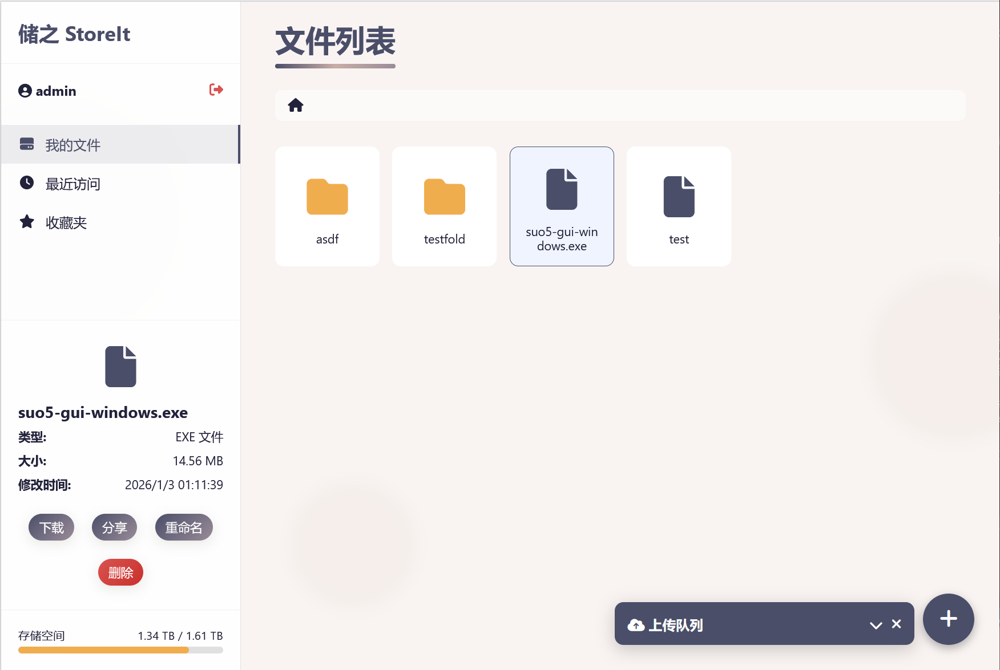

# StoreIt — Modern Self-Hosted File Storage & Federated Sharing Service

[中文](./README.md) | English

A lightweight, modern self-hosted file storage and cross-server federated sharing service built with Spring Boot 3 (JDK 21), SQLite, and Next.js 14 (React 18 + TypeScript). Supports 100GB+ parallel chunked resumable uploads, full Chinese/English internationalization (auto-switching to English whenever the browser language is non-Chinese), 6 UI color themes, invited user self-registration, Read-Only / Read-Write (`R` / `RW`) shared folders, the `SFSP/1.0` Cross-Server Federated Share Protocol, an enhanced live split-screen Markdown editor, and visual YAML system configuration.

Licensed under the [GNU AGPL-3.0 or later](https://www.gnu.org/licenses/agpl-3.0.html) (`AGPL-3.0-or-later`). See [LICENSE](./LICENSE). Source code: <https://github.com/GuilingQiyu/StoreIt>.



[Version Changelog](./Version.md)

Core Defaults:
- Port: `59898`
- Database: `./data/storeit.db` (created and migrated automatically via Flyway `V1`–`V6`)
- Storage root: `./storage/`
- Default admin: `admin / authorized_users` (override via external config)

## Key Features
- **Bilingual Internationalization (i18n) & Automatic Browser Language Switching**:
  - Automatically detects browser language preferences (`navigator.languages`, `navigator.language`, and `Intl` locale); switches the entire UI to English (`en-US`) whenever the primary browser language is not Chinese, and reacts live to browser `languagechange` events.
  - Manual language switcher in both the Login/Register page and the main Navbar supporting **Follow Browser (Auto)**, **简体中文 (`zh-CN`)**, and **English (`en-US`)**, with automatic English translation of common backend status/error messages and bilingual `403.html`, `404.html`, and share download pages.
- **6 Built-in Color Themes**:
  - Includes **Morandi Dusk (Classic)**, **Deep Ocean (Ocean)**, **Emerald Forest (Forest)**, **Amber Sunset (Sunset)**, **Sakura Pink (Sakura)**, and **Midnight Dark (Dark)** themes with instant switching and `localStorage` persistence.
- **Authentication, Sessions & Invited Self-Registration**:
  - Session auth (`POST /api/login`, `POST /api/logout`, `GET /api/user/status`, `POST /api/user/password`) with brute-force rate limiting (5 failed attempts per IP + username within 15 minutes).
  - Invited self-registration (`POST /api/register`): Administrators can create and manage invitation codes (`GET/POST/DELETE /api/admin/invites`) with custom usage limits, expiration hours, initial storage quota, and notes, and copy one-click sign-up links (`/login?invite=ST-XXXX-XXXX`).
- **100GB+ Resumable Chunked Uploads & File Operations**:
  - Single-shot upload (`POST /api/upload` for files ≤ 50 MB) and 5 MB parallel chunked resumable upload (`POST /api/upload/{init,chunk,complete}`, `GET /api/upload/status`, `DELETE /api/upload/{uploadId}`, up to 100 GB by default).
  - Drag-and-drop file and multi-level folder upload with interactive conflict resolution (**Merge**, **Auto Rename**, **Overwrite**).
  - Create blank or template files online (`POST /api/file/create`), create folders (`POST /api/folder/create`), single & batch move/copy/delete, rename, streaming multi-item ZIP download (`GET /api/download/zip`), and full storage index resync (`POST /api/files/resync`).
- **Media Preview & Enhanced Live Split-Screen Markdown Editor**:
  - Inline preview (`GET /api/preview?path=...`) for images (`png`, `jpg`, `gif`, `webp`, `avif`, `apng`, `ico`), video/audio (with HTTP Range streaming), and PDF, with previous/next navigation and fullscreen mode.
  - Online text/code editor (`GET / PUT /api/file/content` up to 5 MB) with automatic UTF-8 / GB18030 / UTF-16 charset detection and optimistic concurrency locking (HTTP 409).
  - Enhanced zero-dependency Markdown renderer supporting **Rendered / Split Live Edit / Raw Source** modes, GFM tables, interactive task lists, GitHub Alerts (`[!NOTE]`, `[!TIP]`, `[!IMPORTANT]`, `[!WARNING]`, `[!CAUTION]`), LaTeX math (`$...$` & `$$...$$`), inline Mermaid flowcharts & sequence diagrams, syntax highlighting, `diff` blocks, `<kbd>` keycaps (`++Ctrl+S++`), and footnotes.
- **Read-Only (`READ`) / Read-Write (`READ_WRITE`) Shared Folders & SFSP/1.0 Federation**:
  - Share individual files or entire folders (`POST /api/share`) with optional expiration, download limits, access code (`X-StoreIt-Share-Password`), and `READ` or `READ_WRITE` permissions.
  - Public direct download at `GET /d/{token}` (folders are streamed as ZIP archives; `HEAD` requests and social link preview bots do not consume download counts).
  - **SFSP/1.0 Federated Endpoints (`/api/fed/shares/{token}/*`) & Mounts (`/api/shares/mounts`)**: Mount local or remote StoreIt shares via URL, token, or `storeit+fed://` URI to browse, preview, download, and collaboratively edit/upload files across servers.
- **Admin Console & Visual YAML Configuration**:
  - Manage users (`GET/POST /api/admin/users`, `PATCH /api/admin/users/{username}`, `POST /api/admin/users/{username}/password`), invitation codes (`/api/admin/invites`), and external configuration files (`GET/POST /api/admin/config` for `./config/application.yml` and `./config/admin.yml` with visual form mode, raw YAML editor, and `.bak` / `.bak.1` automatic backups).

## Quick Start
Prerequisites: JDK 21, Maven (plus Node.js 20+ if rebuilding frontend source)

- Build: `mvn package` (runs integration tests; pre-built frontend static assets are already included in `src/main/resources/static/`. To rebuild the frontend from source, run `npm run export` in `frontend/` first)
- Run: `java -jar target/storeit-2.1.0.jar`

### Frontend Development & Build
1. Enter frontend folder: `cd frontend`
2. Install dependencies: `npm ci` (or `npm install`)
3. Development server: `npm run dev` (proxies `/api/*`, `/storage/*`, `/d/*` to `http://localhost:59898`)
4. Build & sync static export to Spring Boot: `npm run export` (exports static bundle to `out/` and syncs into `src/main/resources/static/`)

### External Admin Credentials & Configuration
Path: `./config/admin.yml` and `./config/application.yml`

```yaml
app:
  default-admin:
    username: admin
    password: your_secret_here
```

Imported via `spring.config.import` (`optional:file:./config/application.yml` followed by `optional:file:./config/admin.yml`). Both files are git-ignored while `*.example` templates are tracked.

## Routes & API Overview
- **Pages**: `/`, `/s/{token}` (public Web Shared Space), `/about`, `/login` (supports `?invite=<CODE>` and `?lang=en|zh|auto`), `/list`
- **Auth**: `POST /api/login`, `POST /api/register`, `POST /api/logout`, `GET /api/user/status`, `POST /api/user/password`
- **Files & Chunked Upload**: `GET /api/files?path=...`, `POST /api/files/resync`, `POST /api/upload`, `POST /api/upload/{init,chunk,complete}`, `GET /api/upload/status`, `DELETE /api/upload/{uploadId}`, `GET /api/preview`, `GET /storage/**`, `GET /api/download/zip`
- **File Operations & Online Editor**: `POST /api/file/create`, `POST /api/folder/{create,resolve-conflict}`, `POST /api/file/{delete,batch-delete,rename,move,batch-move,copy,batch-copy}`, `GET/PUT /api/file/content`, `GET /api/files/{recent,search}`, `GET/POST/DELETE /api/favorites`, `GET /api/storage/usage`
- **Sharing & SFSP/1.0 Federation**: `POST /api/share`, `GET /api/shares`, `DELETE /api/shares/{id}`, `GET /d/{token}`, `GET/POST/DELETE /api/shares/mounts`, `/api/fed/shares/{token}/{manifest,list,preview,download,zip,content,upload,mkdir,create-file,delete,rename}`
- **Administration (`ADMIN` only)**: `GET/POST /api/admin/users`, `PATCH /api/admin/users/{username}`, `POST /api/admin/users/{username}/password`, `GET/POST/DELETE /api/admin/invites`, `GET/POST /api/admin/config`

## Database & Security
- SQLite at `./data/storeit.db` with Flyway migrations (`V1` through `V6`) and `PRAGMA foreign_keys=ON`
- Default admin ensured and synchronized on startup
- Strict `Content-Security-Policy`, `X-Content-Type-Options`, `X-Frame-Options`, `Referrer-Policy`, optional `HSTS`, and path traversal protection
