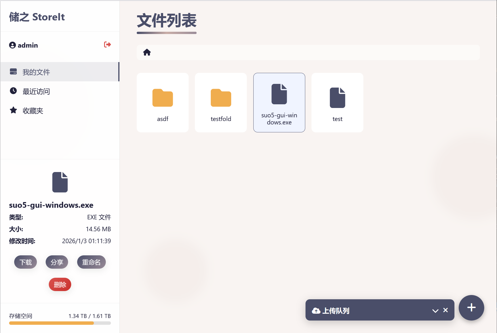

# StoreIt | 储之 — 文件服务应用
中文 | [English](./README-EN.md)

一个基于 Spring Boot 3（JDK 21）、SQLite 与 Next.js 14（React 18 + TypeScript）构建的轻量级、现代化文件存储与跨服联邦共享服务。支持百 GB 级大文件并发分片断点续传、中英双语国际化（非中文浏览器自动切换英文）、6 套主题配色、受邀自助注册、只读/可读写（R/RW）共享文件夹、SFSP/1.0 跨服联邦挂载、增强型 Markdown 在线分屏编辑及可视化 YAML 配置管理。

本程序以 [GNU AGPL-3.0 或更高版本](https://www.gnu.org/licenses/agpl-3.0.html)（SPDX：`AGPL-3.0-or-later`）授权，全文见 [LICENSE](./LICENSE)。通过网络使用本服务时，可在关于页获取源码：<https://github.com/GuilingQiyu/StoreIt>。



[更新日志](./Version.md)

核心默认配置：
- 端口：`59898`
- 数据库：`./data/storeit.db`（自动创建并由 Flyway 自动执行 `V1`–`V6` 迁移）
- 存储根目录：`./storage/`
- 默认管理员：`admin / authorized_users`（可通过外部配置覆盖）

## 功能一览
- **中英双语国际化（i18n）与自动语言切换**：
  - 自动检测浏览器语言环境（`navigator.languages`、`navigator.language` 与 `Intl` 语言环境），当浏览器首选语言非中文时自动切换全站界面至英文（`en-US`），并实时响应浏览器语言切换事件。
  - 登录/注册页右上角与主导航栏均内置语言切换器，支持 **跟随浏览器（Auto）**、**简体中文（`zh-CN`）** 与 **English（`en-US`）** 手动切换，静态错误页（`403.html` / `404.html`）与分享外链页同步自适应中英文。
- **6 套界面主题配色**：
  - 内置 **暮紫莫兰迪（Classic）**、**深海蔚蓝（Ocean）**、**翡翠森绿（Forest）**、**琥珀暖阳（Sunset）**、**樱花粉黛（Sakura）** 与 **极夜暗黑（Dark）** 6 套主题，支持在登录页和导航栏一键切换并持久化保存。
- **认证、会话与受邀自助注册**：
  - 登录/注销与会话状态：`POST /api/login`、`POST /api/logout`、`GET /api/user/status`、`POST /api/user/password`（个人自助改密）。同一 IP 与用户名 15 分钟内连续失败 5 次后暂时拒绝。
  - 受邀自助注册：`POST /api/register`。管理员可在后台通过 `GET/POST/DELETE /api/admin/invites` 生成邀请码（可配置可用次数、有效期、受邀用户初始配额及备注），并一键复制注册邀请链接（`/login?invite=ST-XXXX-XXXX`）。
- **大文件并发分片上传与日常文件管理**：
  - 单次上传 `POST /api/upload`（≤ 50 MB）与 5 MB 并发分片断点续传（`POST /api/upload/{init,chunk,complete}`、`GET /api/upload/status`、`DELETE /api/upload/{uploadId}`，默认上限 100 GB）。
  - 支持文件与多级文件夹拖拽上传、同名文件/同名文件夹冲突策略选择（合并、自动重命名、覆盖）。
  - 支持在线新建空白或模板文件（`POST /api/file/create`）、新建文件夹（`POST /api/folder/create`）、单文件与批量移动/复制/删除、重命名、流式 ZIP 打包下载（`GET /api/download/zip`）及物理目录全量索引校准（`POST /api/files/resync`）。
- **多媒体内联预览与增强型 Markdown 分屏编辑器**：
  - 在线预览 `GET /api/preview?path=...`：原生内联支持常见图片（含 `avif`、`apng`、`webp`、`ico`）、音视频（支持 HTTP Range 拖动播放）与 PDF；支持同目录「上一个 / 下一个」快捷切换与全屏展开。
  - 在线文本与代码编辑 `GET / PUT /api/file/content`：自动识别 UTF-8 / GB18030 / UTF-16 编码并支持乐观锁防覆盖校验（HTTP 409）。
  - 增强型 Markdown 渲染器：支持「渲染视图 / 分屏实时编辑 / 源码视图」切换，支持 GFM 表格、交互式任务列表（点击复选框直接写回源码）、GitHub 提示块（`[!NOTE]` / `[!TIP]` / `[!IMPORTANT]` / `[!WARNING]` / `[!CAUTION]`）、LaTeX 数学公式（`$...$` / `$$...$$`）、内嵌 Mermaid 流程图与时序图、代码语法高亮、`diff` 增删对比、按键标签（`++Ctrl+S++`）与脚注。
- **只读（R）/ 读写（RW）共享文件夹与 SFSP/1.0 跨服联邦共享**：
  - 支持对单文件或整个文件夹生成分享链接（`POST /api/share`），可配置有效期、最大下载次数、可选提取码保护（`X-StoreIt-Share-Password`）以及 **只读（`READ`）** 或 **可读写（`READ_WRITE`）** 权限。
  - 公开直链下载 `GET /d/{token}`（文件夹自动流式打包为 ZIP；对 `HEAD` 与社交软件预览爬虫不扣减下载次数）。
  - **SFSP/1.0 跨服联邦接口（`/api/fed/shares/{token}/*`）** 与 **共享挂载（`/api/shares/mounts`）**：支持通过分享链接、Token 或 `storeit+fed://` 协议挂载本机或远端 StoreIt 实例的共享空间，在工作台内直接浏览、预览、下载或在 `READ_WRITE` 权限下协同编辑、上传与管理文件。
- **管理员用户管理与可视化系统设置**：
  - 用户与邀请码管理：`GET/POST /api/admin/users`、`PATCH /api/admin/users/{username}`（修改配额、角色、启用/禁用状态）、`POST /api/admin/users/{username}/password`（重置口令及强制首次登录改密标记）、`GET/POST/DELETE /api/admin/invites`。
  - 系统设置：`GET/POST /api/admin/config`，支持通过可视化表单或 YAML 原文编辑器维护 `./config/application.yml` 与 `./config/admin.yml`，自动保留 `.bak` / `.bak.1` 两代备份。
- **健康检查与安全防护**：
  - `GET /actuator/health` 无需登录；其余 Actuator 端点不暴露。
  - 会话 Cookie 设置 `HttpOnly` / `SameSite=Lax`（`app.ssl-enabled: true` 时附加 `Secure`）；严格下发 `Content-Security-Policy`、`X-Content-Type-Options`、`X-Frame-Options`、`Referrer-Policy`（HTTPS 下附带 `Strict-Transport-Security`）；内置路径安全检查防止目录穿越。

## 快速开始
前置要求：JDK 21、Maven（如需修改构建前端还需 Node.js 20+）

- 构建：`mvn package`（会运行全部集成测试；`src/main/resources/static/` 已内置最新前端静态构建产物，如需重新编译前端请先在 `frontend` 目录执行 `npm run export`）
- 运行：`java -jar target/storeit-2.1.0.jar`

### 前端开发与构建
StoreIt 前端基于 Next.js 14、React 18、TypeScript、Tailwind CSS、shadcn/ui、TanStack Query 与 Zustand 构建，通过静态导出（`output: 'export'`）嵌入 Spring Boot 单可执行 JAR：

1. 进入前端目录：`cd frontend`
2. 安装依赖：`npm ci`（或 `npm install`）
3. 开发预览：`npm run dev`（内置反向代理，开发时 API 请求自动转发至后端 `http://localhost:59898`）
4. 构建并同步静态产物：`npm run export`（执行静态导出并将产物自动同步至 `src/main/resources/static/`）

可选：通过外部配置文件覆盖默认配置（适用于生产环境独立 JAR 部署）：

1) 复制示例配置到本地 `config/` 目录：
	- `cp config/application.yml.example config/application.yml`
	- `cp config/admin.yml.example config/admin.yml`
2) 按需修改 `config/*.yml` 后启动服务。应用启动时先加载 `./config/application.yml`，再加载 `./config/admin.yml`（同名配置以后者为准）。

### 外部管理员凭据（推荐）
本项目通过 Spring Boot `spring.config.import` 支持从外部文件加载管理员用户名与口令，避免在代码仓库中存放明文凭据：

- 外部文件路径：`./config/admin.yml`
- 示例内容：

```yaml
app:
  default-admin:
    username: admin
    password: your_secret_here
```

`application.yml` 已配置：
```yaml
spring:
  config:
    import:
      - optional:file:./config/application.yml
      - optional:file:./config/admin.yml
```
仓库的 `.gitignore` 已忽略实际的 `config/*.yml`（仅保留 `*.example`），适合直接携带 release JAR 进行外部化部署。

> **安全建议：务必修改默认凭据**
> 内置默认管理员 `admin / authorized_users` 仅为「开箱即用」，**严禁在生产/公网环境直接使用**。
> 部署前请通过外部配置覆盖为强口令，应用启动时会自动使用新口令重算 BCrypt 哈希并同步到数据库：
>
> ```yaml
> # config/admin.yml
> app:
>   default-admin:
>     username: your_admin
>     password: <一段足够长的随机口令>
> ```
>
> 补充加固建议：
> - **启用 HTTPS**：在 `config/application.yml` 配置 `server.ssl.*` 并设 `app.ssl-enabled: true`，会话 Cookie 会自动附加 `Secure`，并下发 HSTS。
> - **置于反向代理之后**：由 Nginx/Caddy 终止 TLS。应用已对同一 IP 与用户名做登录失败限流，代理层可进一步配置连接限流。
> - **拒绝内置口令启动**：在 `config/application.yml` 设置 `app.require-custom-admin: true` 后，若口令仍为默认 `admin / authorized_users`，进程会拒绝启动。
> - **设置用户配额**：`storage_quota`（字节）大于 0 时，上传与在线编辑保存前会校验个人目录已占用空间（自动排除 `.chunks` 临时目录），超出则拒绝；0 表示不限额。

### 路由与 API 说明
- **页面路由**：
	- `GET /` -> `static/index.html`（支持 `#/files`、`#/files/<path>`、`#/recent`、`#/favorites`、`#/shares`、`#/s/<token>`、`#/admin`、`#/settings`、`#/about`、`#/search` 视图路由）
	- `GET /s/{token}` -> `static/index.html`（免登录直接打开指定分享的 Web 共享空间）
	- `GET /about` -> `static/index.html`（直接打开「关于」标签页）
	- `GET /login` -> `static/login.html`（支持 `?invite=<CODE>` 或 `#register` 直接切换至受邀注册模式，支持 `?lang=en|zh|auto` 语言参数）
	- `GET /list` -> 重定向至 `/`
- **认证与个人账号**：
	- `POST /api/login`（表单：`username`、`password`）
	- `POST /api/register`（JSON：`{"username","password","inviteCode"}`）
	- `POST /api/logout`
	- `GET /api/user/status`（返回 `logged_in`、`username`、`role`、`must_change_password`）
	- `POST /api/user/password`（JSON：`{"oldPassword","newPassword"}`）
- **文件与分片上传**：
	- `GET /api/files?path=...` — 列出目录内容
	- `POST /api/files/resync` — 扫描物理存储目录并全量同步 `file_metadata` 数据库索引
	- `POST /api/upload` — 单次上传文件（≤ 50 MB，字段：`file`、`directory`、`conflictStrategy`）
	- `POST /api/upload/init`、`POST /api/upload/chunk`、`GET /api/upload/status`、`POST /api/upload/complete`、`DELETE /api/upload/{uploadId}` — 特大文件（> 50 MB，默认上限 100 GB）5 MB 分片并发上传、断点续传、合并与取消清理
	- `GET /storage/**` — 已登录受保护单文件下载
	- `GET /api/download/zip?paths=...` — 多文件或文件夹流式打包 ZIP 下载
	- `GET /api/preview?path=...` — 已登录内联预览（支持 HTTP Range）
	- `GET /api/file/content?path=...`、`PUT /api/file/content` — 文本类文件在线读取与保存（≤ 5 MB，支持 `charset` 与 `expectedModifiedTime` 乐观锁校验）
	- `POST /api/file/create` — 在线新建空白或模板文件（`parentPath`、`fileName`、`content`、`conflictStrategy`）
	- `POST /api/folder/create`、`POST /api/folder/resolve-conflict` — 新建文件夹与同名文件夹冲突决策（`merge` / `rename` / `overwrite`）
	- `POST /api/file/delete`、`POST /api/file/batch-delete`、`POST /api/file/rename`、`POST /api/file/move`、`POST /api/file/batch-move`、`POST /api/file/copy`、`POST /api/file/batch-copy` — 删除 / 重命名 / 移动 / 复制（含批量）
	- `GET /api/files/recent`、`GET /api/files/search?q=`、`GET/POST/DELETE /api/favorites`、`GET /api/storage/usage` — 最近文件、搜索、收藏夹与存储配额统计
- **分享、共享文件夹与跨服联邦协议（SFSP/1.0）**：
	- `POST /api/share` — 创建文件或文件夹分享（支持 `filePath`、`expireHours`、`maxDownloads`、`permission` [`READ` | `READ_WRITE`]、`accessPassword`、`title`）
	- `GET /api/shares`、`DELETE /api/shares/{id}` — 列出与撤销本人创建的分享
	- `GET / HEAD /d/{token}` — 公开直链下载（支持提取码验证，文件夹自动打包为 ZIP）
	- `GET / POST / DELETE /api/shares/mounts` — 列出、添加与移除已挂载的外部/跨服共享空间
	- `GET /api/fed/shares/{token}/manifest`、`GET /api/fed/shares/{token}/list`、`GET /api/fed/shares/{token}/preview`、`GET /api/fed/shares/{token}/download`、`GET /api/fed/shares/{token}/zip`、`GET/PUT /api/fed/shares/{token}/content`、`POST /api/fed/shares/{token}/upload`、`POST /api/fed/shares/{token}/mkdir`、`POST /api/fed/shares/{token}/create-file`、`POST /api/fed/shares/{token}/delete`、`POST /api/fed/shares/{token}/rename` — SFSP/1.0 跨服联邦共享读写接口（通过 `X-StoreIt-Share-Password` 请求头或 `password` 参数传递提取码）
- **管理员接口（仅 `ADMIN` 角色）**：
	- `GET / POST /api/admin/users`、`PATCH /api/admin/users/{username}`、`POST /api/admin/users/{username}/password` — 用户管理与口令重置
	- `GET / POST / DELETE /api/admin/invites` — 注册邀请码管理
	- `GET / POST /api/admin/config` — 外部配置文件读取、可视化更新与 YAML 原文保存

### 数据库存储
- SQLite 数据库：`./data/storeit.db`
- Flyway 自动迁移脚本（`src/main/resources/db/migration/`）：
	- `V1__init.sql`：`users`、`sessions`、`file_shares` 基础表
	- `V2__roles_quota_and_metadata.sql`：用户角色、`storage_quota` 与 `file_metadata` 表
	- `V3__share_token_unique.sql` ~ `V5__user_status_and_password_policy.sql`：分享唯一索引、账号启用状态与强制改密策略
	- `V6__invites_and_shared_folders.sql`：`invite_codes` 邀请码表、`share_mounts` 跨服挂载表以及 `file_shares` 文件夹共享权限/提取码/标题字段
- 每个 SQLite 连接执行 `PRAGMA foreign_keys=ON`，连接池固定 1 个连接以避免 SQLite 并发写锁冲突。

### 目录结构（关键部分）
- `frontend/` — Next.js 14 + React 18 + TypeScript 前端工程源码
- `storage/` — 文件存储根目录
- `src/main/resources/static/` — 前端静态导出资源（内置预构建产物）
- `src/main/resources/static/error/` — 403 / 404 自包含双语错误页
- `src/main/resources/db/migration/` — Flyway SQL 迁移脚本（`V1`–`V6`）
- `config/application.yml` — 外部应用配置（不入库，先于管理员配置加载）
- `config/admin.yml` — 外部管理员配置（不入库）
